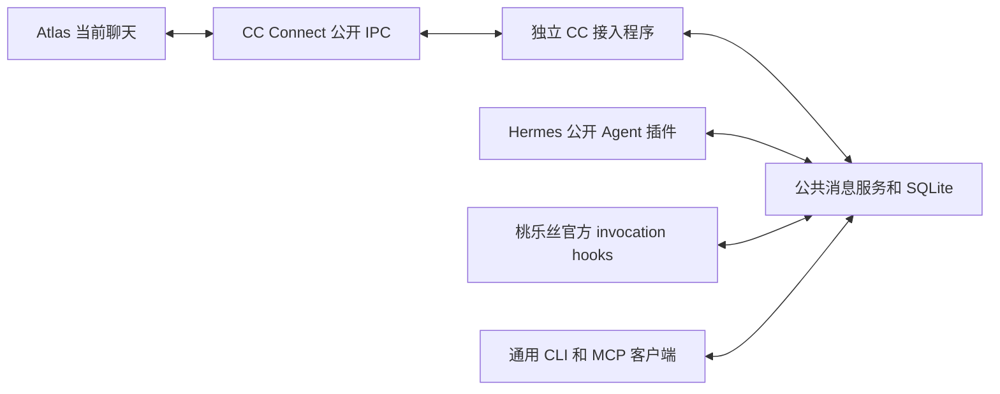

# 本机公共 Agent 消息服务

本服务把“保存和传送任务消息”从模型执行器中分离。服务长期运行；Atlas、Hermes、桃乐丝仍按各自入口执行任务。接入程序负责证明真实会话身份，服务不靠进程名、昵称或工作目录猜测接收者。

## 组成

Go 模块不导入 CC Connect。服务只监听私有 Unix socket，保存成员、消息、领取和回执，不加载模型凭据、不执行任务。CC 接入程序使用已有的聊天解析和事件接口，因此安装新服务无需替换或重启 CC Connect。

Hermes 在任务 overlay 中加载插件，经公开 Agent API 收件；桃乐丝在每任务配置中加载官方 PreInvocation / PostInvocation hooks。消息进入下一次模型调用边界，不改变已经发出的模型请求。模型用固定自身身份的工具查看成员、发送消息、取件和确认。

## 身份和通信范围

受信启动器先持久保存登记请求和随机令牌，再请求服务分配稳定 `mailbox_id`。响应丢失时重试同一登记，避免创建第二个身份。模型只使用自己的 binding；管理令牌用于启动器登记。

`scope` 表示已核实的聊天或宿主范围。CC 的指纹包含项目、完整平台聊天键、真实工作目录和真实 socket 路径，用 JSON 数组编码后取 SHA-256，字段边界明确。用户、话题与工作区保持隔离。

`team` 表示本次共同任务。相同 scope、相同非空 team 的执行成员可以互相联系；执行成员也可以联系自己的协调者。服务根据 `coordinator` 布尔值和父子关系判断权限，`kind` 和昵称只用于展示。发信必须使用精确邮箱编号。

邮箱长期保留，`generation` 表示一次真实执行。准确续谈沿原邮箱创建新代次；结束代次不能复活。原生会话 ID 初次未知时可以留空，同代次首次补齐后不能改变。子 Agent 不继承根成员的收件身份。

Atlas 邮箱固定到聊天；`/new` 后接入程序从公开接口确认当前线程，结束旧代次并建立新代次。旧消息保留原投递证据，不因换线程重发。

## 消息和恢复

接口与完整字段以 [PROTOCOL.md](PROTOCOL.md) 为准。

发送方为每条逻辑消息固定 `client_message_id`。同编号、同内容返回原记录，内容变化被拒绝。服务保存与原生执行器接纳分别记录，状态为 `pending`、`dispatching`、`offered`、`accepted`、`unknown`；成员实际收件使用独立的 `received_at`。这些状态都不等于业务完成。

接入端先用只读游标查看收件箱，仅对实际待收消息申请领取。领取的 `request_id` 先持久保存，响应不明时沿原请求恢复；新请求必须来自活跃代次。同一请求重放可以查询已结束代次的历史结果，但不能在新代次重新领取原消息。

已经尝试向原生执行器投递的消息不自动退回待发。CC 接入持久保存同一个下游事件及 payload，通过公开回执对账；只有接收端明确证明尚未提交时才重试原事件。hook 已输出只记 `offered`，成员显式确认另外记收件，避免虚报已接纳。

服务重启保存全部事实，不靠心跳超时抢占执行者。任务完成后释放模型容量，邮箱和未读消息保留；后续由原任务的准确续谈入口接续。

## 启动与兼容

启动器在服务可用、宿主身份已核实的情况下自动登记新任务。给双方传相同 `--team` 即要求任务内通信；服务或必要接入缺失时，应在启动模型前明确失败。旧请求和已经运行的原生任务保持原配置，安装文件不会凭空赋予旧进程实时收件能力。

工作区两个任务入口分别支持六个主任务。共享材料用只读来源；写入使用独立任务目录或 Git 工作树。公共父目录不作为独占 CWD，相同或祖先/后代写目录继续互斥。模型供应商的请求额度独立计算。

部署和对账见 [维护说明](skill/references/operations.md)。实际发布版本的验证结果单独记录，不能用健康接口成功代替真实模型间往返、Atlas 收件和恢复验证。
